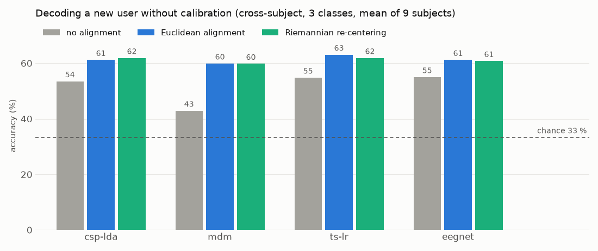

<p align="center">
  
</p>

<h1 align="center">OpenMind Core</h1>

<p align="center">
  <b>The AI core of OpenMind BCI.</b><br>
  A standard EEG stream in, generic commands out: <code>left</code>, <code>right</code>, <code>forward</code>, <code>rest</code>, <code>action</code>.
</p>

<p align="center">
  <a href="https://github.com/openmind-bci/core/actions/workflows/ci.yml"></a>
  <a href="LICENSE"></a>
  
  
</p>

> [!WARNING]
> **Research and experimentation project — not a medical device.**
> OpenMind Core must not be used for diagnosis, treatment or any clinical decision,
> nor to control anything where an error could harm someone.

Core listens to a standard EEG stream, recognizes what the user intends
(imagined left hand, right hand, feet, rest, or a double jaw clench), and
publishes **generic commands** over MQTT. The goal is fast onboarding: thanks to
transfer learning and session alignment, a new user should be ready after a few
minutes of calibration instead of a long training session.

## Where it fits

```
 ┌──────────────────────────┐     ┌────────────────────────┐     ┌──────────────────────┐
 │  plug                    │     │  core  (this repo)     │     │  sandbox             │
 │  any EEG source          │────▶│  preprocessing         │────▶│  robot, digital twin │
 │  → standard LSL stream   │ LSL │  decoder + calibration │MQTT │  wheelchair, bird... │
 └──────────────────────────┘     │  → OpenMind commands   │     └──────────────────────┘
                                  └────────────────────────┘
```

| Repository | Role |
|---|---|
| [plug](https://github.com/openmind-bci/plug) | EEG source → standard LSL stream ([stream specification](https://github.com/openmind-bci/plug/blob/main/docs/stream-spec.md)) |
| **core** (this one) | LSL stream → user intent → MQTT commands |
| [sandbox](https://github.com/openmind-bci/sandbox) | Virtual and real objects driven by those commands |

Core never talks to a headset (that is plug) and knows nothing about objects (that
is sandbox): the decoder says `left`, never "turn the robot's wheel".

## Commands

| Command | Mental task | Signal |
|---|---|---|
| `left` | imagine moving the left hand | mu / beta drop over the right motor cortex (C4) |
| `right` | imagine moving the right hand | mu / beta drop over the left motor cortex (C3) |
| `forward` | imagine walking / moving the feet | mu / beta drop at the vertex (Cz, CPz) |
| `rest` | relax | default when nothing is detected |
| `action` | double jaw clench: clench, release at least 0.3 s, clench | **muscle** burst (EMG) on every electrode, a hybrid switch rather than a brain signal |

Decoding uses montage C: eight electrodes over the motor cortex
(`FC3, FC4, C3, Cz, C4, CP3, CP4, CPz`). Why these eight and why the jaw rather
than a blink: [montage study](docs/montage.md), [action gesture study](docs/action-gesture.md).

## Results so far

Every decoder is evaluated on public datasets (BCI Competition IV 2a, PhysioNet
EEGMMIDB) under three protocols: within-session, cross-session and
cross-subject. Cross-subject is the one that matters for fast onboarding: it
measures how well a model trained on other people works for someone new.

<picture>
  <source media="(prefers-color-scheme: dark)" srcset="docs/media/alignment-dark.png">
  
</picture>

*Aligning each session on its own mean covariance lifts every decoder for a new
user by 6 to 17 points, without a single labelled trial from that user
(BCI Competition IV 2a, left / right / feet, montage C).*

| Study | Result tables |
|---|---|
| Classical baselines (CSP + LDA, MDM, tangent space + logistic regression) | [baselines.md](research/results/baselines.md) |
| Deep models (EEGNet, ShallowConvNet) vs baselines | [deep.md](research/results/deep.md) |
| Montage C: eight motor electrodes | [montage-c.md](research/results/montage-c.md) |
| Session alignment (Euclidean, Riemannian re-centering) | [alignment.md](research/results/alignment.md) |
| Double jaw clench detector | [jaw.md](research/results/jaw.md) |

Protocols and discussion: [docs/evaluation.md](docs/evaluation.md).

## Status

Pre-alpha. The offline pipeline is in place; the real-time loop is next.
See [CHANGELOG.md](CHANGELOG.md).

| Component | Status |
|---|---|
| OpenMind protocol (`openmind-protocol`: JSON Schemas, models, safety `Watchdog`) | available |
| Public datasets (MOABB), causal preprocessing, epochs | available |
| Baselines and deep models, local model registry | available |
| Session alignment (`openmind_core.alignment`) | available |
| Double jaw clench detector (`JawClenchDetector`) | available |
| Calibration trials rebuilt from Plug / Sandbox markers (`TrialCollector`) | available |
| Fast calibration (fine-tuning, cold start by similarity) | planned |
| User profiles (`openmind-core profile`) | planned |
| Real-time loop: LSL in, MQTT commands and heartbeat out (`openmind-core online`) | planned |
| Band power for the 3D brain (`openmind/v1/bandpower`) | available (`openmind-core bandpower`) |

## Installation

Requires Python 3.11+ and [uv](https://docs.astral.sh/uv/).

```bash
git clone https://github.com/openmind-bci/core.git
cd core
uv sync                      # core + protocol (workspace) + dev tools
uv sync --extra research     # + MOABB and MLflow for experiments
uv sync --extra deep         # + PyTorch and Braindecode
uv sync --extra plug         # + openmind-plug, to reuse its LSL inlet
uv run openmind-core --help
```

## Quick start

Train and compare decoders on a public dataset (downloaded on first use into
`OPENMIND_DATA_DIR`):

```bash
uv sync --extra research
uv run python research/experiments/benchmark.py --config research/configs/baselines.yaml
```

Train a model on a public dataset and register it (needs the `research` extra,
and `deep` for `eegnet` / `shallow`):

```bash
uv run openmind-core train --dataset bnci2014_001 --subjects 1-9 \
    --model ts-lr --channels C --alignment riemann
# registered as ts-lr-bnci2014_001-c-riemann in $OPENMIND_DATA_DIR/models
```

Decode a live stream and publish commands (needs the `plug` extra, a broker and a
profile; the first 30 s of an aligned model are a warm-up, then the reference is
saved in the profile). Add `--dry-run` to print the decisions without a broker:

```bash
uv run openmind-core profile create P01
uv run openmind-core online --profile P01 --model ts-lr-bnci2014_001-c-riemann
```

Feed the 3D brain of the sandbox from a Plug stream (add `--dry-run` to print the
frames instead of publishing them, no broker needed):

```bash
uv sync --extra plug
uv run openmind-core bandpower --broker localhost:1883 --user P01 --expected C
```

Or use the building blocks directly:

```python
from openmind_core.alignment import Aligner
from openmind_core.models import make_baseline

X = Aligner("riemann").fit_transform(epochs.X)  # re-center the session
model = make_baseline("ts-lr").fit(X, epochs.y)
model.predict(X[:5])  # "left", "right", "forward"
```

Objects talk to Core through the protocol package only:

```python
from openmind_protocol import decode_topic

message = decode_topic("openmind/v1/commands", payload)  # validated, typed
```

## The OpenMind protocol

Published from [`protocol/`](protocol/) as the `openmind-protocol` package: the
contract with sandbox and with any object.

| Topic | Content |
|---|---|
| `openmind/v1/commands` | `{"v":1,"command":"left","confidence":0.87,"ts":…,"user":"P03","seq":42}` |
| `openmind/v1/status` | decoder heartbeat, at least 2 Hz |
| `openmind/v1/markers` | calibration cues and events (also relayed on LSL) |
| `openmind/v1/events` | object telemetry and events |
| `openmind/v1/score` | progress score |
| `openmind/v1/bandpower` | power per electrode and band, about 10 Hz |

**Safety rule:** every real object stops if it receives no `status` for 2 s,
and ignores commands below its confidence threshold. Details in
[docs/protocol.md](docs/protocol.md).

## Repository layout

| Path | Content |
|---|---|
| `src/openmind_core/` | the decoder: I/O, preprocessing, models, alignment, calibration, online loop |
| `protocol/` | the command protocol (`openmind-protocol` package, the contract with sandbox) |
| `research/` | experiments, benchmark configs, results and notes; never imported by `src/` |
| `docs/` | [architecture](docs/architecture.md), [train your model](docs/train-your-model.md), [pipeline](docs/pipeline.md), [evaluation](docs/evaluation.md), [montage](docs/montage.md), [action gesture](docs/action-gesture.md), [protocol](docs/protocol.md), [profiles](docs/profiles.md), [scoring](docs/scoring.md), [calibration](docs/calibration.md) |
| `tests/` | tests of `openmind-core` |

## Data and privacy

EEG data are health data. Core processes everything **locally**. Datasets,
profiles and model weights live outside the repository, in `OPENMIND_DATA_DIR`
(default `~/openmind-data`), and users are identified only by pseudonyms
(`P01`, `P02`...).

## Contributing

See [CONTRIBUTING.md](CONTRIBUTING.md).

## License

[Apache-2.0](LICENSE).
